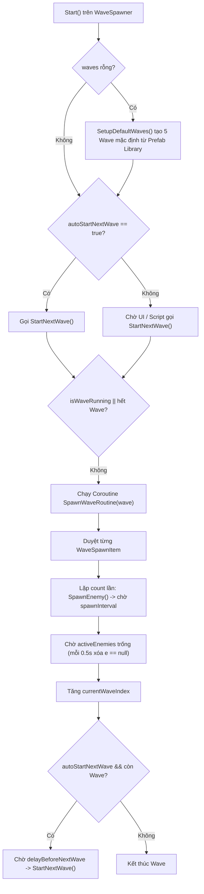

# Hướng dẫn hoạt động Hệ thống Spawn (`WaveSpawner`) – UngrownCastle

Tài liệu này mô tả chi tiết kiến trúc, luồng hoạt động và cách cấu hình tính năng Spawn Enemy trong dự án **UngrownCastle**.

---

## 1. Tổng quan kiến trúc

Hệ thống Spawn được tổ chức xoay quanh 3 thành phần chính:

| Thành phần | File | Vai trò |
|---|---|---|
| **`WaveSpawner`** | [`Assets/Scripts/Wave/WaveSpawner.cs`](Assets/Scripts/Wave/WaveSpawner.cs) | Quản lý danh sách Wave, điều phối Coroutine sinh quái và theo dõi tiến độ Wave. |
| **`WaveData`** | [`Assets/Scripts/Wave/WaveSpawner.cs`](Assets/Scripts/Wave/WaveSpawner.cs) | Dữ liệu của 1 Wave (`waveName`, danh sách `spawnItems`, `delayBeforeNextWave`). |
| **`WaveSpawnItem`** | [`Assets/Scripts/Wave/WaveSpawner.cs`](Assets/Scripts/Wave/WaveSpawner.cs) | Cấu hình từng loại quái trong Wave (`enemyPrefab`, `count`, `spawnInterval`). |
| **`Enemy`** | [`Assets/Scripts/Enemies/Enemy.cs`](Assets/Scripts/Enemies/Enemy.cs) | Script gắn trên mỗi Prefab quái: tự gán layer `Enemy`, tìm `Castle`, đi bộ và tấn công. |

---

## 2. Luồng hoạt động (Workflow)

### Chi tiết từng bước:

1. **Khởi tạo (`Start()`)**:
   - Nếu danh sách `waves` trong Inspector đang trống (`waves.Count == 0`), `SetupDefaultWaves()` sẽ tự động tạo tối đa 5 Wave mặc định dựa trên các Prefab đã kéo vào `Enemy Prefab Library` (Slime → Zombie → Kobold → Ork & Troll → Harpy & Tauren).
   - Nếu `autoStartNextWave` được bật (`true`), `StartNextWave()` được gọi ngay lập tức để chạy Wave đầu tiên.

2. **Bắt đầu Wave (`StartNextWave()`)**:
   - Kiểm tra `isWaveRunning` để tránh chạy chồng 2 Wave cùng lúc.
   - Kiểm tra `currentWaveIndex >= waves.Count` để dừng khi đã hoàn thành tất cả Wave.
   - Kích hoạt `StartCoroutine(SpawnWaveRoutine(waves[currentWaveIndex]))`.

3. **Sinh quái theo từng đợt (`SpawnWaveRoutine`)**:
   - Đặt `isWaveRunning = true`.
   - Với mỗi `WaveSpawnItem` trong `wave.spawnItems`:
     - Bỏ qua nếu `enemyPrefab == null`.
     - Lặp `item.count` lần: gọi `SpawnEnemy(item.enemyPrefab)` rồi `yield return new WaitForSeconds(item.spawnInterval)`.
   - Sau khi spawn đủ tất cả item trong Wave, vòng lặp `while (activeEnemies.Count > 0)` kiểm tra mỗi `0.5f` giây và loại bỏ các Enemy đã bị tiêu diệt (`e == null`).
   - Khi sạch quái: log `CLEARED!`, đặt `isWaveRunning = false`, tăng `currentWaveIndex++`. Nếu `autoStartNextWave == true` và vẫn còn Wave kế tiếp, chờ `wave.delayBeforeNextWave` giây rồi tự gọi `StartNextWave()`.

4. **Tạo thực thể Enemy (`SpawnEnemy`)**:
   - Lấy tọa độ ngang `baseX` từ `spawnPoint.position.x` (nếu `spawnPoint == null` thì fallback về `defaultSpawnX`).
   - Kiểm tra thuộc tính `IsFlying` trên `Enemy`:
     - Nếu `IsFlying == true` (ví dụ `Harpy`): dùng độ cao `flyingY`.
     - Nếu `IsFlying == false` (quái đi bộ): dùng độ cao `groundY`.
   - Cộng thêm độ lệch ngẫu nhiên theo trục X (`Random.Range(-0.15f, 0.15f)`) để quái không đè khít lên cùng 1 điểm.
   - `Instantiate(prefab, pos, Quaternion.identity)` và ép `localScale.x` về số âm để Enemy luôn quay mặt sang trái về phía `Castle`.
   - Thêm vào danh sách `activeEnemies`.

5. **Vòng đời của Enemy sau khi Spawn (`Enemy.cs`)**:
   - `Awake()`: nếu đang ở layer `0` (`Default`), tự chuyển sang layer `Enemy` để các Hero dùng `Physics2D.OverlapCircleAll(..., enemyLayer)` phát hiện được; đồng thời gọi `FindCastle()` tìm GameObject tên `"Castle"`.
   - `Start()`: khởi tạo trạng thái `EnemyState.Moving` và bật Walk Animation (`walkAnimation.SetAttacking(false)`).
   - `Update()`: di chuyển theo hướng về `Castle.position.x` (hoặc `castleStopX` nếu chưa có `Castle`). Khi `Mathf.Abs(targetX - transform.position.x) <= attackRange` hoặc chạm collider/trigger của `Castle` (`isTouchingCastle`), Enemy dừng di chuyển và chuyển sang `EnemyState.Attacking` (`walkAnimation.SetAttacking(true)` + `PerformAttack()`).

---

## 3. Các trường cấu hình trong Inspector (`WaveSpawner`)

| Nhóm | Trường | Ý nghĩa |
|---|---|---|
| **Spawn Settings** | `Spawn Point` | Transform đánh dấu vị trí X spawn (thường đặt ở rìa phải màn hình). |
| | `Default Spawn X` | Tọa độ X dự phòng nếu chưa gán `Spawn Point`. |
| | `Ground Y` | Độ cao Y cho quái đi bộ (`IsFlying == false`). |
| | `Flying Y` | Độ cao Y cho quái bay (`IsFlying == true`, như Harpy). |
| **Waves Configuration** | `Waves` | Danh sách `WaveData` tùy chỉnh trực tiếp trong Inspector. |
| | `Auto Start Next Wave` | Tự động chạy Wave 1 khi vào game và tự chuyển tiếp các Wave sau. |
| **Enemy Prefab Library** | `Slime..Tauren Prefab` | Kho Prefab dùng khi `Waves` rỗng để `SetupDefaultWaves()` tự sinh Wave mặc định. |

---

## 4. Cấu hình Wave kiểm tra sẵn trong `TestScene.unity`

Trong [`Assets/Scenes/TestScene.unity`](Assets/Scenes/TestScene.unity), `WaveSpawner` và `SpawnPoint` đã được cấu hình sẵn **1 Wave kiểm tra** (`Wave 1 - Test Wave`) với `autoStartNextWave = true`:

- **`SpawnPoint`**: vị trí `(9.5, -1.5, 0)` bên phải màn hình, cùng mặt đất với `Castle` (`x: -5.17, y: -1.08`).
- **`Ground Y`**: `-1.5` | **`Flying Y`**: `1.5`
- **Thành phần Wave 1 - Test Wave**:
  1. `Slime` (`Assets/Prefabs/Enemies/Slime.prefab`) — **3 con**, cách nhau `1.2s` (quái mặt đất, nhảy nảy)
  2. `Zombie` (`Assets/Prefabs/Enemies/Zombie.prefab`) — **3 con**, cách nhau `1.2s` (quái đi bộ 2 chân, vung vũ khí)
  3. `Harpy` (`Assets/Prefabs/Enemies/Harpy.prefab`) — **2 con**, cách nhau `1.5s` (quái bay, spawn ở `Flying Y = 1.5`)
- **Enemy Prefab Library**: đã gán đầy đủ cả 8 Prefab (`Slime`, `Zombie`, `Kobold`, `Cannibal`, `Ork`, `Troll`, `Harpy`, `Tauren`).

### Cách kiểm tra nhanh trong Unity:
1. Mở [`Assets/Scenes/TestScene.unity`](Assets/Scenes/TestScene.unity) và nhấn **Play**.
2. Quan sát Console & Scene/Game view:
   - Quái xuất hiện lần lượt tại `X ≈ 9.5` (Slime & Zombie ở `Y = -1.5`, Harpy ở `Y = 1.5`), quay mặt trái và chạy Walk Animation tiến về `Castle`.
   - Hero trong Scene (ví dụ `Zeus` đang có sẵn trong `TestScene`) tự động phát hiện Enemy gần nhất trong `attackRange` và tấn công.
   - Click chuột trái trực tiếp lên Hero để kích hoạt Active Skill ngay từ đầu game, sau đó chờ hết Cooldown (`6s`) để dùng lại.
   - Khi quái tiến sát `Castle` trong `attackRange` (hoặc chạm collider `Castle`), quái dừng lại và chuyển sang Attack Animation đánh liên tục.

---

## 5. Cách thêm Wave mới hoặc kích hoạt bằng nút UI

- **Thêm Wave tùy chỉnh**: Chọn GameObject `WaveSpawner` trong Hierarchy → mở mục **Waves** → tăng Size hoặc bấm `+` → đặt `Wave Name`, thêm các phần tử vào `Spawn Items` (chọn Prefab, `Count`, `Spawn Interval`) và chỉnh `Delay Before Next Wave`.
- **Dùng Wave mặc định**: Đặt list **Waves** về `Size = 0` và kéo đầy đủ Prefab vào **Enemy Prefab Library**.
- **Kích hoạt thủ công bằng UI Button**:
  1. Tắt `Auto Start Next Wave` nếu muốn người chơi tự bấm nút bắt đầu Wave.
  2. Ở Component `Button` → **On Click ()** → kéo GameObject `WaveSpawner` vào → chọn **`WaveSpawner -> StartNextWave()`**.
- **Test nhanh trong Editor**: Chuột phải vào tiêu đề component `WaveSpawner` trên Inspector → chọn **Start Next Wave** (`[ContextMenu("Start Next Wave")]`).
